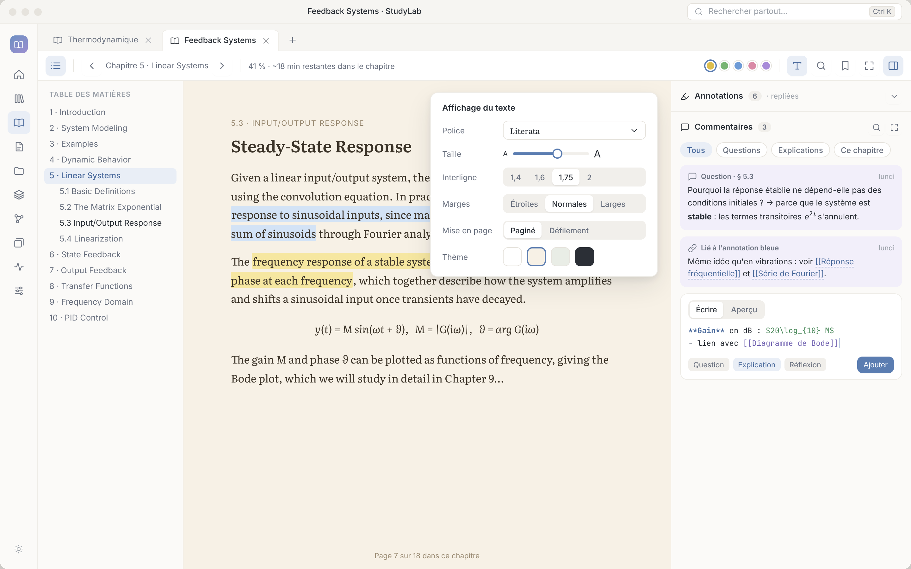

# StudyLab

> **Read – Annotate – Understand – Connect – Learn**

StudyLab est une application de bureau (C++20 / Qt 6) pour lire, annoter, commenter, organiser et réviser ses documents PDF et EPUB, et transformer une bibliothèque en base de connaissances personnelle. Hors ligne, sans compte, sans cloud.

Plateformes cibles : **Windows 10/11 x64** et **Debian 13 x64**.

## État du projet

| Phase | Contenu | État |
|---|---|---|
| 1 · Conception | Vision, architecture, choix des bibliothèques, schéma SQLite, maquettes, plan | ✅ Terminée — voir [`docs/design/`](docs/design/README.md) |
| 2 · MVP | Bibliothèque, lecteurs PDF/EPUB, annotations, commentaires, sauvegarde, export Markdown | 🚧 En cours — itération 2/7 (bibliothèque) |
| 3 · Connaissances (V1) | Notes Markdown, liens, matières, collections, graphe, recherche universelle | — |
| 4 · Apprentissage (V2) | Cartes mémoire, répétition espacée, fiches, tableau de bord | — |
| 5 · Finalisation | Optimisation, packaging, documentation | — |

### Ce qui fonctionne aujourd'hui (itération 2)

- **Bibliothèque** : grille de couvertures ou liste, recherche instantanée (titre, auteur, éditeur, tags, ISBN, DOI ;
  accents ignorés), filtres par statut, format, tag et favoris, tri (récents, ouverts récemment, titre, auteur).
- **Import** de PDF et EPUB : fichiers, dossiers (récursif) ou glisser-déposer n'importe où dans la fenêtre ;
  en arrière-plan avec progression et annulation, détection des doublons par empreinte SHA-256, vérification du
  contenu (faux PDF, EPUB invalide ou protégé par DRM), rapport détaillé. Mode **copie** (par défaut) ou **lien**.
- **Métadonnées** lues dans les fichiers (dictionnaire PDF, OPF EPUB 2/3 : titre, auteurs, éditeur, date, langue,
  ISBN, DOI, sujets) et **couvertures** (première page du PDF, image de couverture de l'EPUB) ; couverture générée
  pour les documents qui n'en ont pas.
- **Panneau de détail** : statut de lecture, favori, modification des métadonnées et des tags, retrait.
- Socle (itération 1) : thème clair / sombre / système, taille d'interface, SQLite avec migrations, contrôle
  d'intégrité, sauvegardes, tests automatisés et intégration continue Windows + Debian 13.

| | |
|---|---|
|  |  |

Les lecteurs PDF/EPUB et les annotations arrivent dans les itérations suivantes
(plan : [`docs/design/07-versions-mvp-v1-v2.md`](docs/design/07-versions-mvp-v1-v2.md)).

## Compiler

Voir [`docs/build.md`](docs/build.md). En bref, sur Debian 13 :

```sh
./scripts/install-deps-debian.sh && ./scripts/build.sh
```

## Maquettes

| | |
|---|---|
|  |  |
|  |  |

Toutes les maquettes : [`docs/design/05-maquettes.md`](docs/design/05-maquettes.md).

## Pile technique

Qt 6.8 LTS (Widgets, PDF, WebEngine) · CMake · SQLite (FTS5) · md4c · KaTeX · foliate-js · libzip · Tesseract (optionnel). Détails et licences : [`docs/design/03-comparaison-bibliotheques.md`](docs/design/03-comparaison-bibliotheques.md).

## Licence

StudyLab est un logiciel libre distribué sous **GNU General Public License v3.0 ou ultérieure** (GPL-3.0-or-later). Voir [`LICENSE`](LICENSE).

Les dépendances tierces conservent leurs propres licences (LGPL-3.0, MIT, BSD, Apache-2.0, domaine public, OFL), toutes compatibles avec la GPL-3.0.
