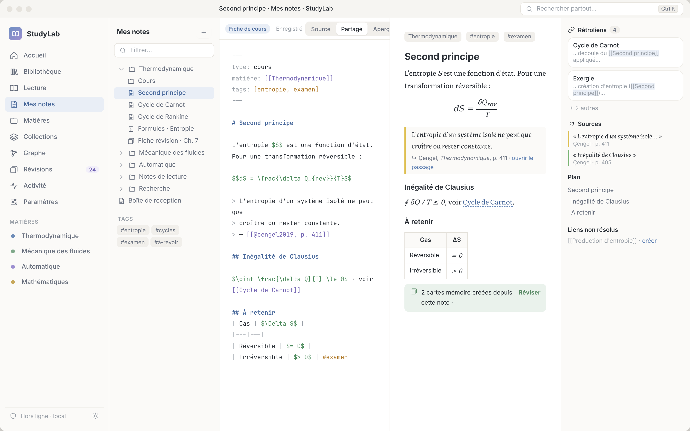

# StudyLab

> **Read – Annotate – Understand – Connect – Learn**

StudyLab est une application de bureau (C++20 / Qt 6) pour lire, annoter, commenter, organiser et réviser ses documents PDF et EPUB, et transformer une bibliothèque en base de connaissances personnelle. Hors ligne, sans compte, sans cloud.

Plateformes cibles : **Windows 10/11 x64** et **Debian 13 x64**.

## État du projet

| Phase | Contenu | État |
|---|---|---|
| 1 · Conception | Vision, architecture, choix des bibliothèques, schéma SQLite, maquettes, plan | ✅ Terminée — voir [`docs/design/`](docs/design/README.md) |
| 2 · MVP | Bibliothèque, lecteurs PDF/EPUB, annotations, commentaires, sauvegarde, export Markdown | ⏳ À venir |
| 3 · Connaissances (V1) | Notes Markdown, liens, matières, collections, graphe, recherche universelle | — |
| 4 · Apprentissage (V2) | Cartes mémoire, répétition espacée, fiches, tableau de bord | — |
| 5 · Finalisation | Optimisation, packaging, documentation | — |

Aucun code applicatif n'est encore publié : ce dépôt contient pour l'instant la conception validée.

## Maquettes

| | |
|---|---|
|  |  |
|  |  |

Toutes les maquettes : [`docs/design/05-maquettes.md`](docs/design/05-maquettes.md).

## Pile technique

Qt 6.8 LTS (Widgets, PDF, WebEngine) · CMake · SQLite (FTS5) · md4c · KaTeX · foliate-js · libzip · Tesseract (optionnel). Détails et licences : [`docs/design/03-comparaison-bibliotheques.md`](docs/design/03-comparaison-bibliotheques.md).

## Licence

StudyLab est un logiciel libre distribué sous **GNU General Public License v3.0 ou ultérieure** (GPL-3.0-or-later). Voir [`LICENSE`](LICENSE).

Les dépendances tierces conservent leurs propres licences (LGPL-3.0, MIT, BSD, Apache-2.0, domaine public, OFL), toutes compatibles avec la GPL-3.0.
