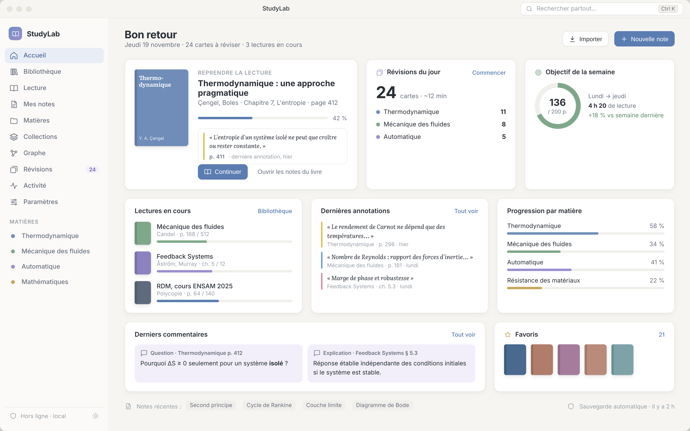
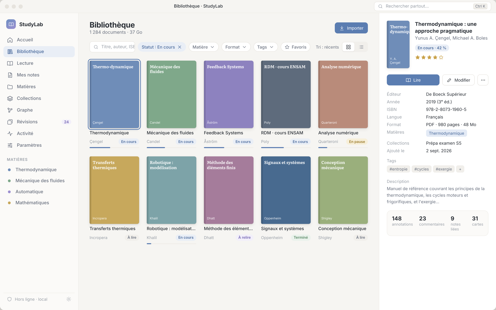
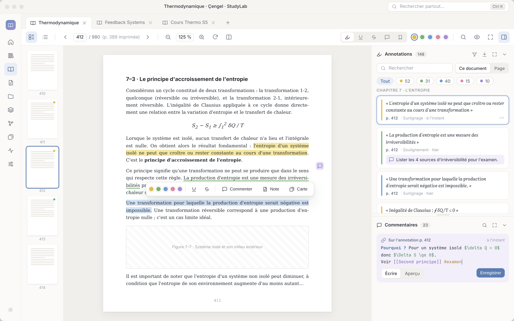
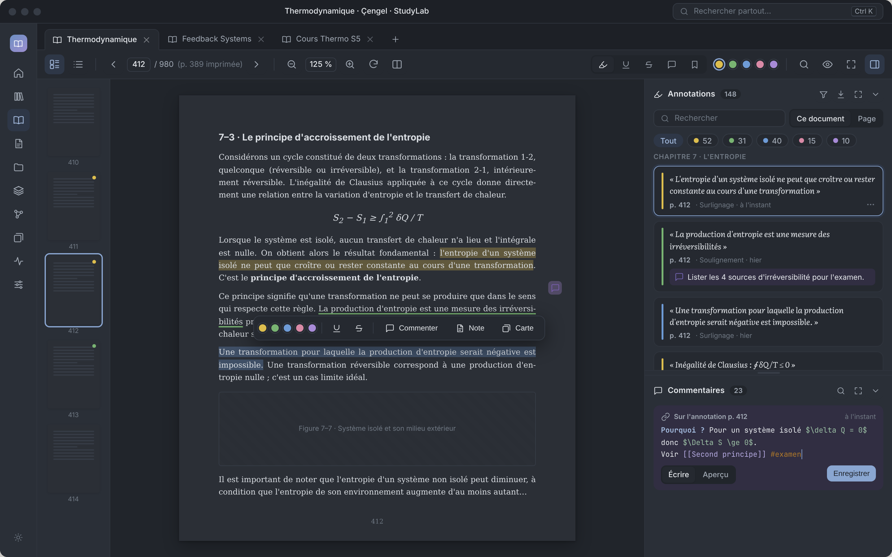
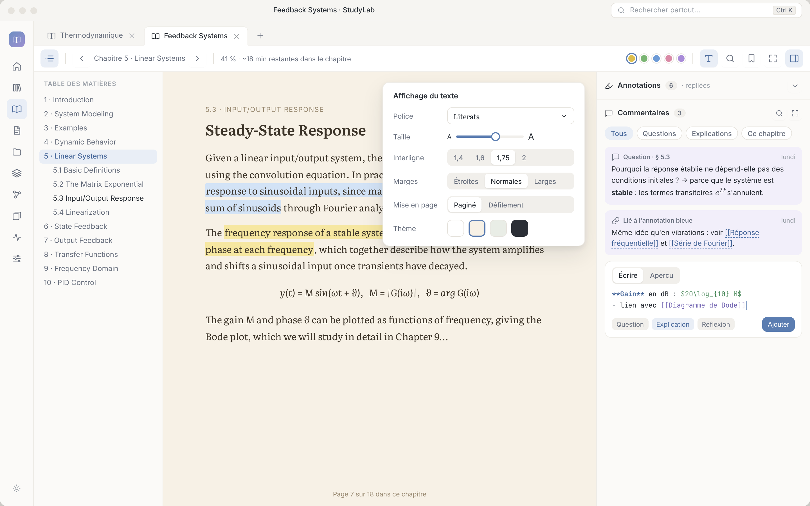
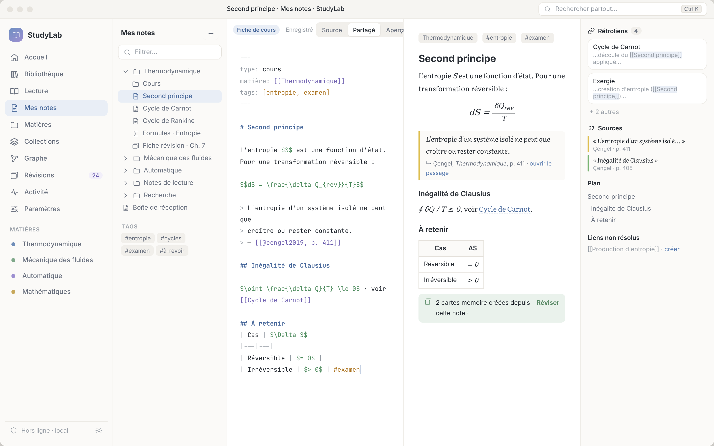
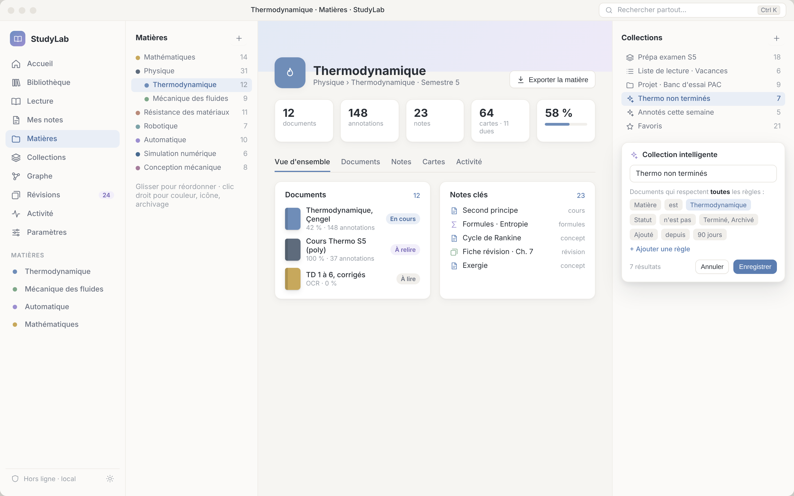
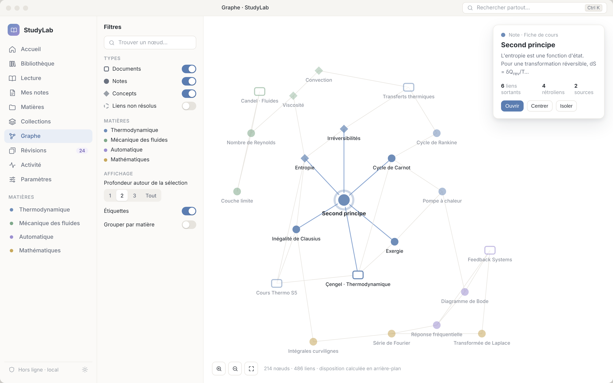
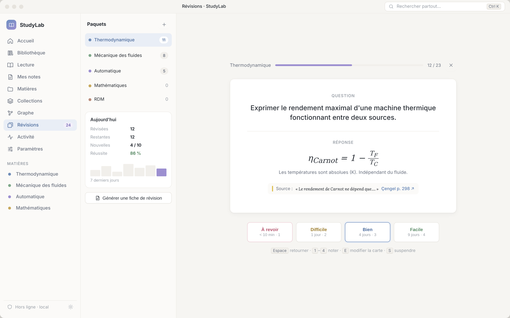
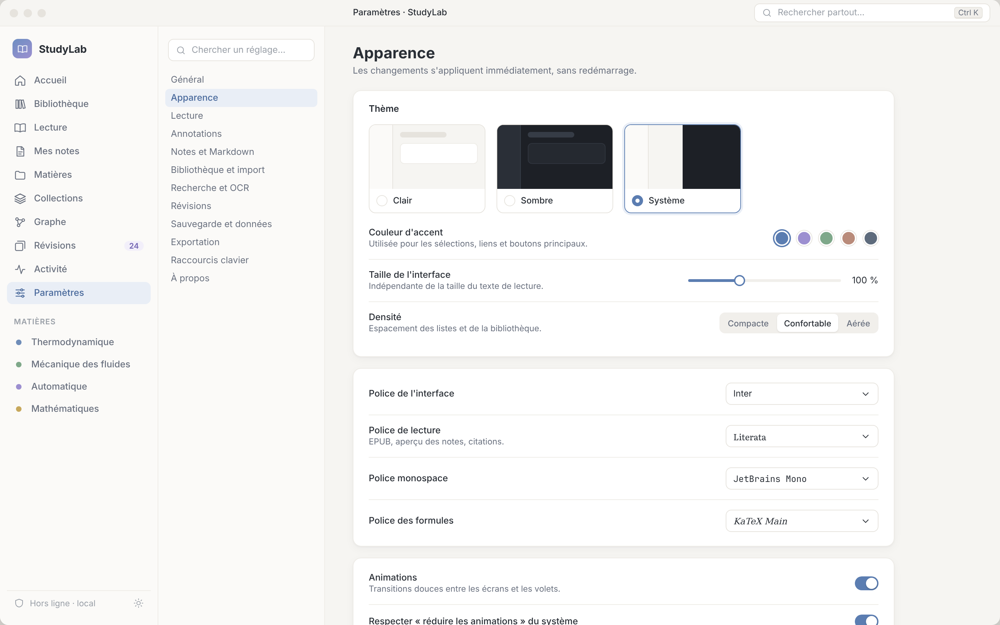

# 5. Maquettes détaillées de l'interface

Source unique : [`maquettes/studylab-maquettes.html`](maquettes/studylab-maquettes.html) (ouvrir dans un navigateur). Captures 2× dans [`maquettes/png/`](maquettes/png/). Toutes les maquettes partagent les mêmes jetons (couleurs, rayons, ombres, typographie), la même navigation et les mêmes composants : c'est ce qui garantit qu'aucun écran ne semble venir d'une autre application. Les données affichées sont fictives.

## Système visuel commun

- **Navigation latérale** : 228 px, icônes au trait homogènes, élément actif sur fond bleu ardoise très pâle, badge lavande pour les révisions dues, raccourcis vers les matières. En lecture, elle se réduit en **rail d'icônes** de 60 px.
- **Barre de titre** : nom du contexte + recherche universelle permanente (Ctrl K).
- **Cartes** : rayon 12 px, bordure presque invisible, ombre à 4 %.
- **Statuts de lecture** : pastilles colorées discrètes (bleu = en cours, gris = à lire, sauge = terminé, ambre = en pause, lavande = à relire).
- **Trois registres de texte, jamais confondus** :
  1. Texte original : serif sur fond « papier ».
  2. Annotation : citation serif *italique* entre guillemets, barre verticale de la couleur d'annotation, référence de page en petites capitales.
  3. Commentaire personnel : sans-serif droit, fond lavande pâle, icône bulle.

## 1 · Accueil et tableau de bord

- Bloc principal « Reprendre la lecture » (document, position exacte, dernière annotation, bouton Continuer).
- Révisions du jour par matière, objectif hebdomadaire (anneau sauge).
- Lectures en cours, dernières annotations, progression par matière, derniers commentaires, favoris.
- Ligne basse : notes récentes et état de la sauvegarde. Les statistiques détaillées sont dans **Activité**, pas ici (tableau de bord non surchargé).

## 2 · Bibliothèque

- Filtres en puces combinables (statut, matière, format, tags, favoris), tri, bascule grille/liste (la liste est un tableau à colonnes configurables pour les grosses bibliothèques).
- Couverture, titre, auteur, statut, barre de progression.
- Panneau de détail : métadonnées éditables, matières, collections, tags, description, compteurs (annotations, commentaires, notes liées, cartes).
- Glisser-déposer de fichiers ou dossiers n'importe où : bandeau d'import avec progression et rapport (« 12 importés · 1 doublon ignoré »).

## 3 · Lecteur PDF

- Onglets de documents ouverts. Barre d'outils : miniatures / sommaire, page (avec numéro imprimé), zoom, rotation, double page, outils d'annotation (surligner, souligner, barrer, note, signet) + 5 couleurs, recherche, mode sans distraction, plein écran, affichage des volets.
- Miniatures avec pastille de couleur sur les pages annotées.
- **Menu contextuel de sélection** : couleur en un clic, souligner, barrer, Commenter, créer une Note, créer une Carte.
- Note contextuelle dans la marge (icône lavande).
- **Volet Annotations** (haut) : recherche, portée (document / page), filtres par couleur avec compteurs, regroupement par chapitre, annotation fraîchement créée encadrée, commentaire associé visible sous l'annotation. Actions d'en-tête : filtrer, exporter, agrandir, replier.
- **Poignée** de redimensionnement entre les volets.
- **Volet Commentaires** (bas) : éditeur Markdown (Écrire / Aperçu), lien vers l'annotation concernée, tags, liens `[[…]]`.

### 3 bis · Mode sombre

Anthracite bleuté (`#1D2026`), accents désaturés, surlignages en transparence. Option « inverser les couleurs des pages » dans les paramètres de lecture.

## 4 · Lecteur EPUB

- Table des matières à gauche, chapitre courant en évidence, progression et temps restant estimé.
- Panneau **Affichage du texte** : police, taille, interligne, marges, paginé/défilement, thème (blanc, sépia, vert d'eau, sombre).
- Démonstration de la gestion des volets : Annotations **replié** en en-tête, Commentaires sur toute la hauteur, filtres par type (questions, explications, chapitre).

## 5 · Espace de notes

- Arborescence (dossiers virtuels par matière, types de notes reconnaissables à l'icône), tags.
- Éditeur Markdown avec coloration (front matter YAML, titres, formules, liens, tags) et aperçu côte à côte (modes Source / Partagé / Aperçu).
- Aperçu : formules KaTeX, citations **sourcées** (« ouvrir le passage » ramène au PDF), tableaux, encadré des cartes créées depuis la note.
- Panneau de contexte : rétroliens avec extrait, sources (annotations d'origine), plan, liens non résolus (« créer »).

## 6 · Matières et collections

- Liste hiérarchique des matières (couleur, compteur), exemples modifiables.
- Page de matière : en-tête doux, chiffres clés, onglets (vue d'ensemble, documents, notes, cartes, activité), export de la matière entière.
- Collections : manuelles, listes de lecture, projets, intelligentes (étincelle), favoris.
- **Éditeur de collection intelligente** en règles lisibles (« Matière est Thermodynamique », « Statut n'est pas Terminé, Archivé »…) avec nombre de résultats en direct.

## 7 · Graphe de connaissances

- Formes = types (rectangle = document, rond = note, losange = concept), couleur = matière.
- Sélection : nœud agrandi, voisinage mis en valeur, reste atténué. Fiche du nœud (extrait, liens, actions Ouvrir / Centrer / Isoler).
- Filtres par type, matière, profondeur, étiquettes ; disposition calculée en arrière-plan.

## 8 · Espace de révision

- Paquets par matière avec cartes dues, statistiques du jour et des 7 derniers jours.
- Carte centrée : question, réponse (formules rendues), **source cliquable** (annotation d'origine).
- Quatre boutons de maîtrise avec l'intervalle suivant affiché (À revoir, Difficile, Bien, Facile), raccourcis clavier.
- « Générer une fiche de révision » : produit un **brouillon** de note à partir des annotations et notes de la matière, que l'utilisateur relit.

## 9 · Paramètres

- Catégories : Général, Apparence, Lecture, Annotations, Notes et Markdown, Bibliothèque et import, Recherche et OCR, Révisions, Sauvegarde et données, Exportation, Raccourcis, À propos. Recherche dans les réglages.
- Apparence : thème clair / sombre / système, couleur d'accent (5 teintes douces), taille d'interface, densité, 4 polices (interface, lecture, monospace, formules), animations et respect du réglage système.

## Comportements non visibles sur une image fixe

| Élément | Comportement |
|---|---|
| Survol | Fond `--sunken` sur 120 ms ; jamais de changement de taille |
| Focus clavier | Anneau 2 px bleu ardoise + halo 3 px pâle, sur tous les contrôles |
| Nouvelle annotation | Insérée en tête de son groupe avec un fondu de surbrillance de 600 ms |
| Clic sur une annotation | Défilement doux vers le passage, clignotement du surlignage (2 × 300 ms) |
| Volets | Repli/dépli animés 160 ms ; double-clic sur l'en-tête = agrandir temporairement ; disposition mémorisée par document ou globalement (réglage) |
| Changement d'écran | Fondu croisé 140 ms, pas de glissement |
| Réduction des animations | Toutes les durées à 0 |
